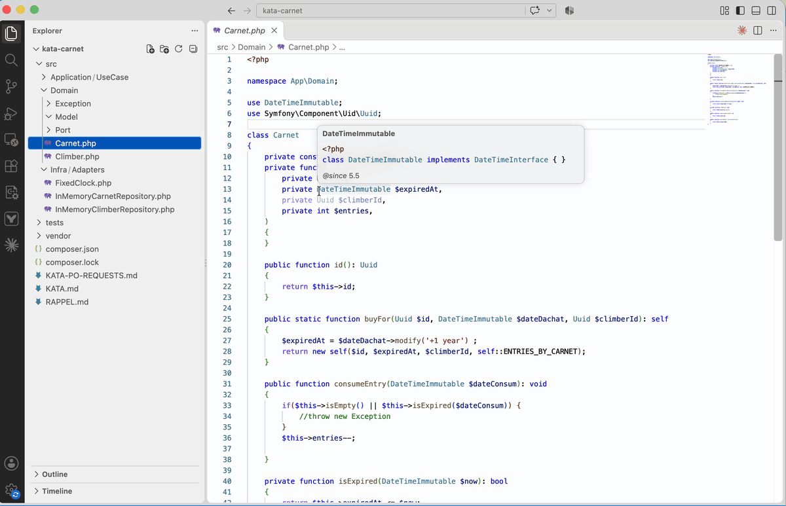
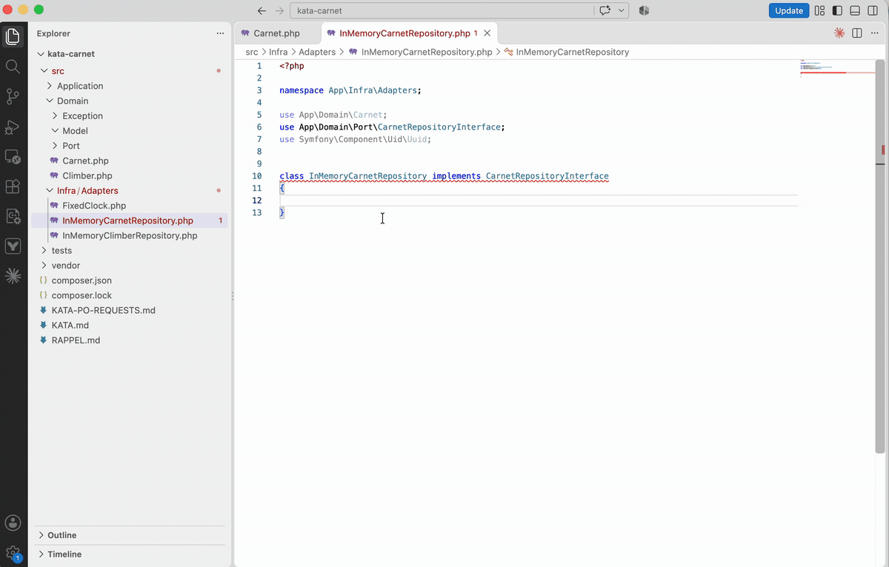
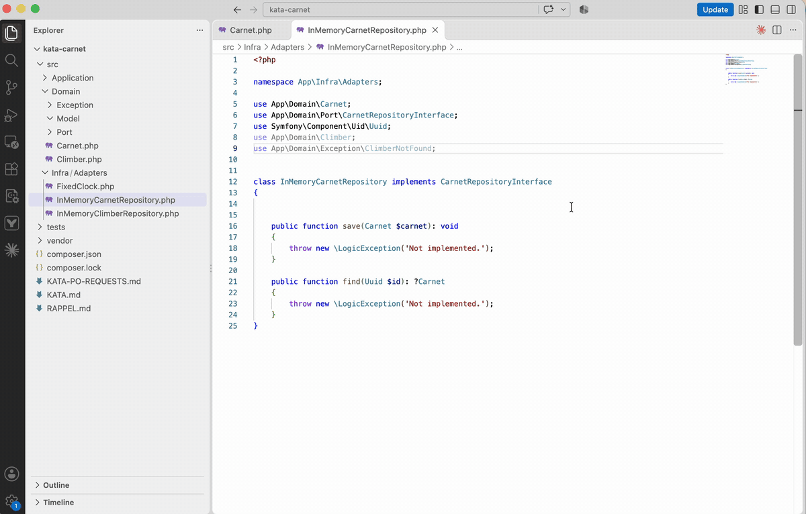

# PHP Refactor Kit

[English](#english) · [Français](#français)

## English

The PhpStorm PHP refactorings that VS Code is missing.

Every action is in the command palette under **PHP Refactor Kit:** (*Implement methods*, *Remove unused imports*,
*Fix namespace*). The relevant ones also show up in VS Code's quick fix menu (`Cmd+.` / `Ctrl+.`).

No shortcut is set by default, so nothing clashes with your keyboard layout or other extensions. To get one, add it in
*Preferences: Open Keyboard Shortcuts (JSON)*, for example:

```json
{ "key": "ctrl+alt+o", "command": "phpRefactorKit.removeUnusedImports", "when": "editorLangId == php" }
```

Commands: `phpRefactorKit.implementMethods`, `phpRefactorKit.removeUnusedImports`,
`phpRefactorKit.fixNamespace`.

### Update namespaces when moving files



When you move (or rename) a PHP file or folder from the explorer, the extension updates:

- the file's `namespace`, computed from the PSR-4 rules (`autoload` / `autoload-dev`) of the nearest `composer.json`;
- the class name, if the file was renamed;
- `use` statements, FQCNs (`\App\...`) and escaped strings (`'App\\...'`) across the project, including YAML/XML/NEON files (Symfony services, Doctrine mappings…);
- the `use` statements that become necessary for classes that shared the old namespace and were therefore used without an import.

If a file's namespace no longer matches its folder (after a `git mv`, a copy-paste…), *Fix namespace* applies
the same update.

### Implement methods



On the declaration of a class that implements an interface or extends an abstract class, `Cmd+.` / `Ctrl+.` offers
**Implement methods** (also in the command palette).
Each missing method is generated with its signature and a body that throws an exception:

```php
public function find(int $id): ?User
{
    throw new \LogicException('Not implemented.');
}
```

Interfaces are looked up in the project and in `vendor/` (through the Composer autoloader), including parent interfaces,
parent classes and traits. Required `use` statements are added. Common built-in interfaces
(`Countable`, `ArrayAccess`, `IteratorAggregate`, `JsonSerializable`, `Stringable`…) are supported.

### Remove unused imports



Removes the `use` statements that are
not referenced in the code or in docblocks (`@param`, `@var`, `@throws`…). Grouped and comma-separated imports
are trimmed item by item. Also available as *PHP Refactor Kit: Remove unused imports* and through VS Code's *Organize Imports*,
so it can run on save:

```json
"[php]": { "editor.codeActionsOnSave": { "source.organizeImports": "explicit" } }
```

### Limitations

- Only moves made inside VS Code are detected (not `mv` or `git mv` in a terminal).
- Lightweight lexical analysis, no AST: grouped imports (`use App\{A, B};`) are not rewritten.
- A short class name appearing in a comment may add an unneeded `use` when moving a file.

### Settings

| Setting | Default |
|---|---|
| `phpRefactorKit.namespace.updateOnMove` | `true` |
| `phpRefactorKit.namespace.exclude` | `**/{vendor,node_modules,var,.git}/**` |
| `phpRefactorKit.namespace.referenceFiles` | `**/*.{yaml,yml,xml,neon}` |
| `phpRefactorKit.namespace.preview` | `false` — show the refactoring preview before applying |
| `phpRefactorKit.namespace.autoSave` | `true` |
| `phpRefactorKit.implement.methodBody` | `throw new \LogicException('Not implemented.');` |

---

## Français

Les refactorings PHP de PhpStorm qui manquent à VS Code.

Toutes les actions sont dans la palette de commandes sous **PHP Refactor Kit:** (*Implement methods*,
*Remove unused imports*, *Fix namespace*). Celles qui sont pertinentes apparaissent aussi dans le menu des corrections
rapides de VS Code (`Cmd+.` / `Ctrl+.`).

Aucun raccourci n'est défini par défaut, pour ne pas entrer en conflit avec votre clavier ou d'autres extensions. Pour
en ajouter un, dans *Preferences: Open Keyboard Shortcuts (JSON)*, par exemple :

```json
{ "key": "ctrl+alt+o", "command": "phpRefactorKit.removeUnusedImports", "when": "editorLangId == php" }
```

Commandes : `phpRefactorKit.implementMethods`, `phpRefactorKit.removeUnusedImports`,
`phpRefactorKit.fixNamespace`.

### Namespace mis à jour au déplacement


Quand on déplace (ou renomme) un fichier ou un dossier PHP depuis l'explorateur, l'extension met à jour :

- le `namespace` du fichier, calculé depuis les règles PSR-4 (`autoload` / `autoload-dev`) du `composer.json` le plus proche ;
- le nom de la classe si le fichier a été renommé ;
- les `use`, FQCN (`\App\...`) et chaînes échappées (`'App\\...'`) dans tout le projet, YAML/XML/NEON compris (services Symfony, mappings Doctrine…) ;
- les `use` à ajouter pour les classes qui partageaient l'ancien namespace et étaient donc utilisées sans import.

Si le namespace d'un fichier ne correspond plus à son dossier (après un `git mv`, un copier-coller…), *Fix namespace*
applique la même mise à jour.

### Implémenter les méthodes


Sur la déclaration d'une classe qui implémente une interface ou étend une classe abstraite, `Cmd+.` / `Ctrl+.` propose
**Implement methods** (aussi dans la palette).
Chaque méthode manquante est générée avec sa signature et un corps qui lève une exception :

```php
public function find(int $id): ?User
{
    throw new \LogicException('Not implemented.');
}
```

Les interfaces sont trouvées dans le projet et dans `vendor/` (via l'autoload Composer), interfaces héritées,
classes parentes et traits compris. Les `use` nécessaires sont ajoutés. Les interfaces natives courantes
(`Countable`, `ArrayAccess`, `IteratorAggregate`, `JsonSerializable`, `Stringable`…) sont connues.

### Supprimer les imports inutilisés


Supprime les `use` qui ne sont
référencés ni dans le code ni dans les docblocks (`@param`, `@var`, `@throws`…). Les imports groupés ou séparés par
des virgules sont nettoyés élément par élément. Aussi disponible via *PHP Refactor Kit: Remove unused imports* et via
*Organize Imports* de VS Code, donc utilisable à l'enregistrement :

```json
"[php]": { "editor.codeActionsOnSave": { "source.organizeImports": "explicit" } }
```

### Limites

- Seuls les déplacements faits dans VS Code sont détectés (pas `mv` ou `git mv` dans un terminal).
- Analyse lexicale légère, pas d'AST : les `use` groupés (`use App\{A, B};`) ne sont pas réécrits.
- Un nom court présent dans un commentaire peut provoquer un `use` superflu lors d'un déplacement.

### Réglages

| Réglage | Défaut |
|---|---|
| `phpRefactorKit.namespace.updateOnMove` | `true` |
| `phpRefactorKit.namespace.exclude` | `**/{vendor,node_modules,var,.git}/**` |
| `phpRefactorKit.namespace.referenceFiles` | `**/*.{yaml,yml,xml,neon}` |
| `phpRefactorKit.namespace.preview` | `false` — aperçu de refactoring avant application |
| `phpRefactorKit.namespace.autoSave` | `true` |
| `phpRefactorKit.implement.methodBody` | `throw new \LogicException('Not implemented.');` |
